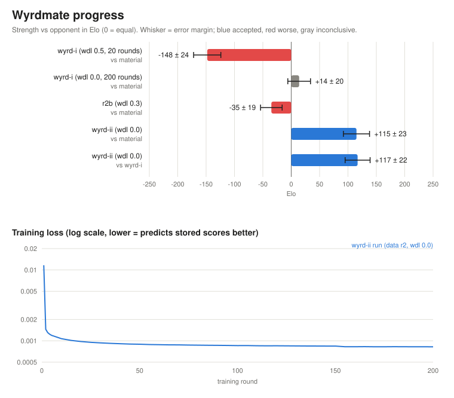

# Wyrdmate

Small, "weak but clever" chess AI for ESP32-class boards (IoT wizard-chess board).
Rust engine + NNUE trained with [bullet](https://github.com/jw1912/bullet).

## Layout

- `engine/` search + eval
- `datagen/` self-play data generation
- `trainer/` bullet training driver
- `firmware/` no_std ESP32 inference (built separately)
- `nets/` quantised nets (commit small ones; record git hash, bullet config, data)

## Progress

The chart is generated from `docs/progress/data.js` by `scripts/make-progress-svg.ps1`.
