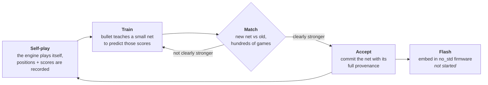
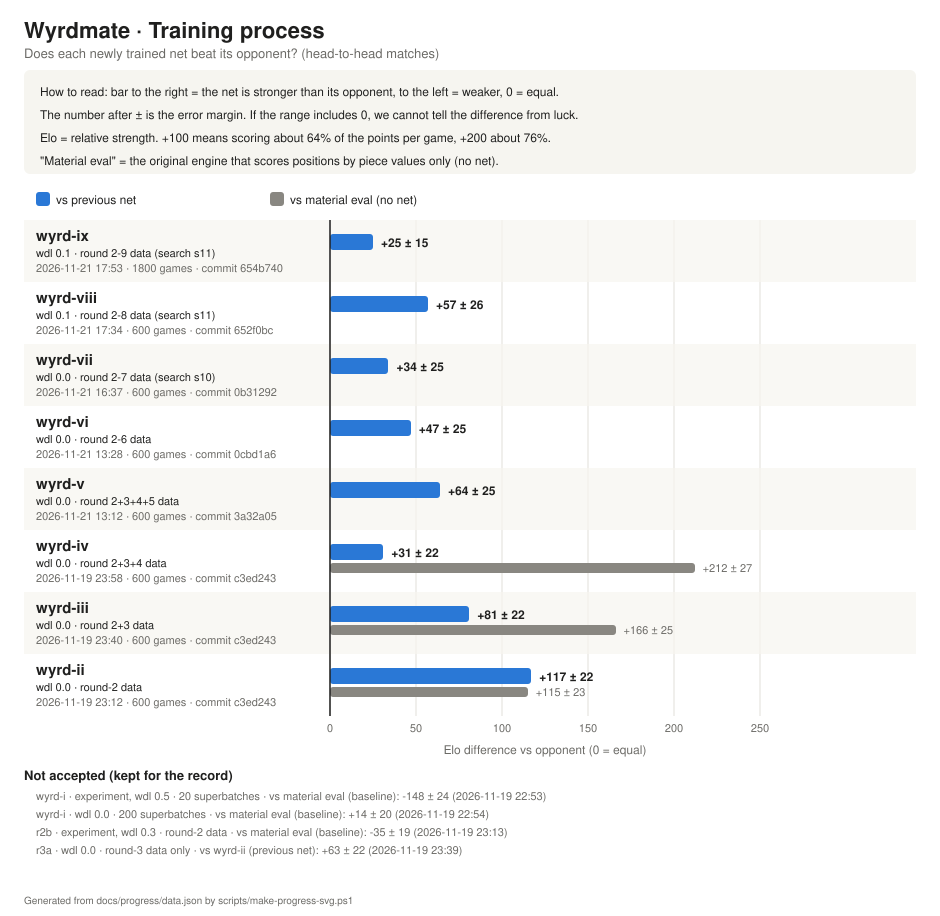
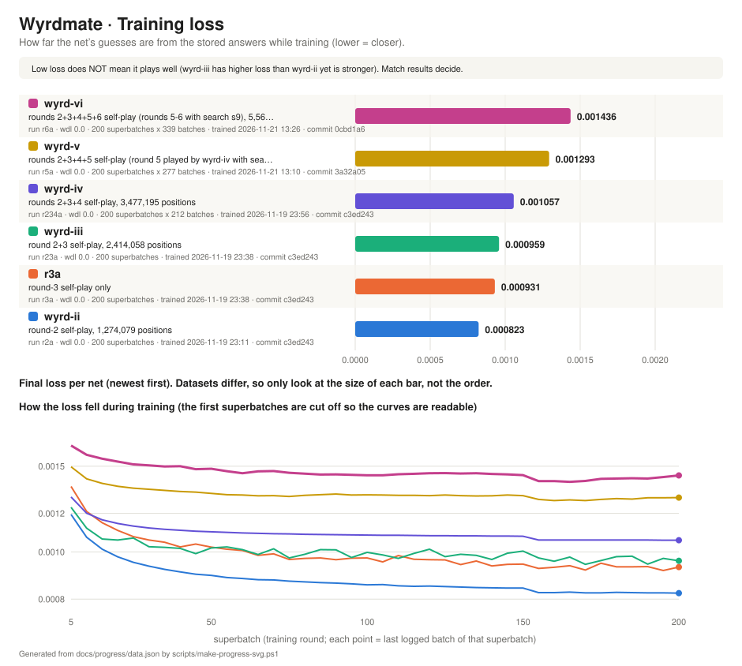

<div align="center">

# Wyrdmate

**Small. Clever. Not too strong.**<br>
A tiny chess AI for ESP32-class boards: a Rust engine with a neural evaluation (NNUE) trained by self-play.


-e7352c?style=flat-square)


</div>

<br>

## What it is

Wyrdmate (*wyrd* = fate, plus *mate*) is the brain of a wizard-chess IoT board. The goal is **not** the strongest engine:
it is one that plays sensibly, fits in a microcontroller, and whose strength you can turn up or down.

It is three parts in a row:

| Part | Job | Learns? |
|---|---|---|
| **Rules** | Which moves are legal (`cozy-chess`) | No |
| **Search** | Look ahead with negamax + alpha-beta + quiescence | No |
| **Evaluation (NNUE)** | Look at a position and say who is better | **Yes, this is what we train** |

> **Strength is a dial, not a hack.** Search is limited by a *node budget* (how many positions the engine may look at before it moves).
> Fewer nodes means a weaker, faster player, with the same net.



## Why it is built this way

| | |
|---|---|
| **Supervised, not AlphaZero** | The net learns from labelled positions made by self-play (trained with [bullet](https://github.com/jw1912/bullet)). No reinforcement-learning loop; a small net on a small board is cheap to retrain. |
| **A match decides, not the loss** | A net is accepted only if it beats the previous one by more than the error margin over hundreds of games. A lower training loss alone proves nothing. |
| **Reproducible nets** | Every committed net lists the code commit, trainer arguments, and the exact data (seeds, nodes, games) that made it. See [`nets/RECORDS.md`](nets/RECORDS.md). |
| **Fits an ESP32** | The net is `(768 → 32) × 2 → 1` in int16, about **49 KB**. Inference is integer maths on int16 weights; the `no_std` port is still to do. |
| **Honest numbers** | Results are Elo against earlier versions of itself, with error margins. Nothing here is measured against outside engines or humans yet. |

## Progress

Strength of each net, measured in matches (600 games each, 10,000 nodes per move, random openings). 0 means equal to the opponent; whiskers are the error margin.

<div align="center">





</div>

Latest accepted net, **`wyrd-iv`** (self-play round 4): **+31 ± 22 Elo** against `wyrd-iii` and **+212 ± 27 Elo** against the original material-counting evaluation. The gain per round is shrinking (+115, +81, +31), so the loop is nearing its plateau.
Full history, including experiments that failed (a net trained to also fit game results lost to the baseline), is in [`nets/RECORDS.md`](nets/RECORDS.md).
The charts are generated from [`docs/progress/data.json`](docs/progress/data.json) by `scripts/make-progress-svg.ps1`.

## Try it

Wyrdmate speaks **UCI**, so it should work with any UCI chess program (not tried with a graphical one yet).

```bash
cargo build --release -p wyrdmate-engine
./target/release/wyrdmate-engine
```

```text
uci
setoption name EvalFile value nets/wyrd-iv.bin      # the trained net (omit for the material-only baseline)
setoption name Nodes value 5000                      # strength: fewer nodes = weaker
position startpos moves e2e4 e7e5
go
```

The engine answers `bestmove ...`. `go nodes N` overrides the budget for one move.

### Play it in a browser

- **Hosted:** <https://anmewzaa.github.io/Wyrdmate/> runs the engine in your browser as WebAssembly (you vs engine, or engine vs engine, any net, any level). Nothing is sent to a server.
- **Locally:** `cargo build --release -p wyrdmate-engine`, then `python scripts/play.py` and open <http://localhost:8001/>.
- The levels in the menu are node limits with a relative Elo measured only between Wyrdmate's own levels ([EVALUATION.md](docs/EVALUATION.md), section 8), not against outside engines.

## Repository layout

| Path | Contents |
|---|---|
| `engine/` | Search, material eval, NNUE inference (`nnue.rs`), UCI front end, examples (`validate`, `book`) |
| `datagen/` | Self-play data generator (optionally played by a net) |
| `trainer/` | [bullet](https://github.com/jw1912/bullet) training driver (pinned to a git revision) |
| `firmware/` | `no_std` ESP32 inference. **Skeleton only**, built separately |
| `nets/` | Accepted nets (`wyrd-i` to `wyrd-iv`) and their [records](nets/RECORDS.md) |
| `docs/` | [Training guide](docs/TRAINING.md), [file-by-file tour](docs/STRUCTURE.md), [decisions](docs/decisions.md), progress data |
| `web/` | The engine as WebAssembly plus the build for the GitHub Pages demo ([web/README.md](web/README.md)). Not a workspace member |
| `scripts/` | Progress charts, the browser play page (`play.py`/`play.html`), a PGN game viewer |

## Build it from scratch

You need Rust (stable). Training also needs an NVIDIA GPU with the CUDA Toolkit; playing and data generation do not.

```bash
cargo test -p wyrdmate-engine                  # engine tests
cargo run --release -p wyrdmate-engine --example validate -- nets/wyrd-iv.bin data/some.txt   # net vs stored scores
```

One round of the loop (see the [training guide](docs/TRAINING.md) for what each step does):

```text
wyrdmate-datagen 2500 5000 <seed> data/part.txt [net.bin]      # 1. self-play data
bullet-utils convert --from text --input data/all.txt --output data/all.data    # 2. convert (bullet-utils is built from the bullet repo)
bullet-utils shuffle --input data/all.data --output data/train.data --mem-used-mb 1024
wyrdmate-trainer data/train.data 200 152 16384 0.0 <name>      # 3. train (cargo feature `cuda`), wdl 0.0
fastchess -engine ... (see CLAUDE.md for the full match recipe) # 4. match new vs old
```

## Documentation

- [docs/README.md](docs/README.md): index of all documentation (Thai)
- [docs/ARCHITECTURE.md](docs/ARCHITECTURE.md): system design and the net file format (Thai)
- [docs/TRAINING.md](docs/TRAINING.md): how the net is made, step by step (Thai)
- [docs/EVALUATION.md](docs/EVALUATION.md): A/B match procedure and acceptance rule (Thai)
- [docs/STRUCTURE.md](docs/STRUCTURE.md): what every file does (Thai)
- [docs/ROADMAP.md](docs/ROADMAP.md) and [docs/GLOSSARY.md](docs/GLOSSARY.md): status, remaining work, terms (Thai)
- [docs/decisions.md](docs/decisions.md): why the project is shaped this way
- [nets/RECORDS.md](nets/RECORDS.md): provenance of every net
- [CLAUDE.md](CLAUDE.md): the contributing guide and hard rules (it is also what coding agents read)

## Status

Working: engine, UCI, data generation, GPU training, NNUE inference, A/B matches, four accepted net generations.
Strength levels are measured as relative Elo between our own node limits (100 to 51,200 nodes).
Measured against Stockfish (strength-limited, used only as a ruler, never as a teacher): the top level (51,200 nodes) plays at roughly Stockfish `UCI_Elo` 1415, a rough figure, not a standard Elo ([EVALUATION.md](docs/EVALUATION.md), section 9).
Not done: the ESP32 firmware (nothing has run on a board yet).

## License

[MIT](LICENSE)
